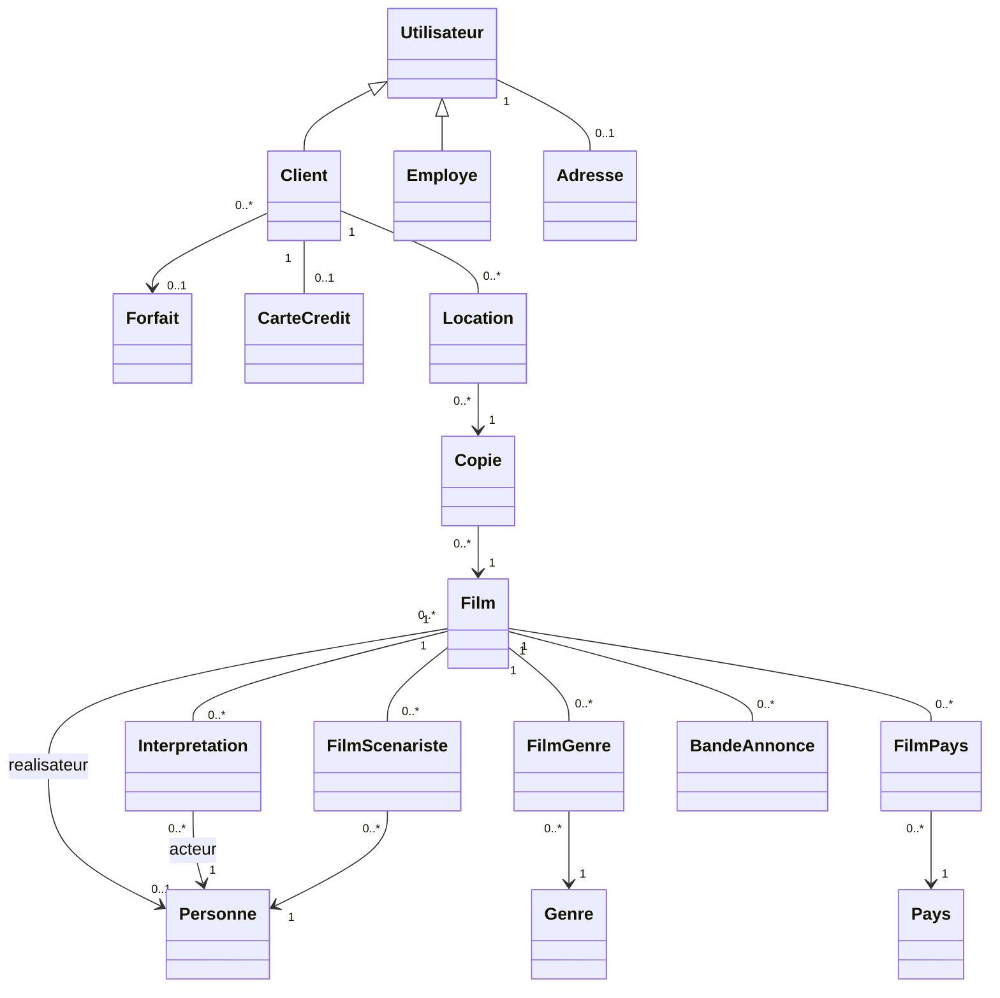

# Conception du backend

## Périmètre et architecture

Le backend reprend les deux projets .NET de l'équipe et couvre seulement les cas
2 (connexion), 3 (consultation) et 4 (location). Le schéma et les scripts du labo 1 restent inchangés.
Entity Framework Core et son fournisseur Oracle assurent le mappage ORM.

Les contrôleurs lisent les demandes et construisent les réponses HTTP. Les services sont
les façades des opérations métier. Les repositories encapsulent les requêtes et
`AppDbContext` fournit le suivi des entités et la transaction. AutoMapper construit
les DTO, qui évitent les cycles de navigation et l'exposition des données sensibles.

Cette séparation permet de modifier une requête sans changer le contrat HTTP et de
vérifier les règles avec une base temporaire. Le client mince n'a pas besoin de connaître
les tables, les jointures ou les étapes d'une location.

## Classes et relations

Les cardinalités facultatives reflètent les colonnes nullables du SQL fourni.
`Employe` complète la hiérarchie existante ; aucune opération de gestion des employés n'est exposée.
Les acteurs, réalisateurs et scénaristes sont des rôles de `Personne`, déterminés par les associations.

## Mappage objet-relationnel

| Élément demandé à la tâche 2 | Choix |
| --- | --- |
| Classe → table | Les 17 tables existantes, identifiées en majuscules. |
| Identifiant | Clé simple ou composée correspondant au SQL. `LOCATION.IDLOCATION` utilise l'identité Oracle. Les autres identifiants existent déjà. |
| Propriété → colonne | Noms, longueurs et valeurs facultatives du schéma. `DATE`, chaînes non Unicode (`VARCHAR2`), `CLOB` et coût à précision 5, échelle 2. |
| Associations | Références, collections et classes d'association explicites. `INTERPRETATION` conserve le personnage dans sa clé composée. |
| Spécialisation | `Client : Utilisateur` et `Employe : Utilisateur`, avec une table par type (TPT). Les clés des sous-classes sont aussi des FK vers `UTILISATEUR`. |

Le TPT correspond au schéma déjà livré : les attributs communs sont dans `UTILISATEUR`,
les attributs spécifiques dans `CLIENT` et `EMPLOYE`. Le chargement d'un client joint
les tables nécessaires. Aucun discriminateur ni nouvelle table n'est requis.
`Adresse` et `CarteCredit` restent des associations un-à-un avec une clé partagée.

Les annotations décrivent les propriétés ; les configurations Fluent complètent les clés,
relations et l'héritage. Les suppressions en cascade et les relations restrictives suivent
les clés étrangères du labo 1. L'application ne crée ni ne migre le schéma au démarrage.
Les propriétés facultatives permettent aussi de lire les données anciennes conservées
par les contraintes `ENABLE NOVALIDATE` du labo 1.

## Connexion et contrôle des accès

`ClientService` recherche un client par courriel. Le mot de passe est comparé exactement
au format existant du labo 1. Un échec ne révèle pas si le courriel existe.
La réponse contient `ClientDto` avec les données personnelles, l'adresse et le forfait.
Le numéro de carte est masqué ; le mot de passe et le CVV restent exclus.

Après une connexion valide, ASP.NET Core protège un ticket contenant l'identifiant du client
et une expiration de 30 minutes. Le jeton est retourné dans `X-Auth-Token`.
Pour louer, le client doit présenter ce jeton dans `Authorization: Bearer ...`.
Le serveur vérifie le jeton et l'égalité entre son identifiant et celui du corps JSON.
Le catalogue reste public. Le mécanisme fonctionne sans cookie et sans nouvelle table.
Le frontend devra transmettre cet en-tête lors de son intégration.

## Consultation

Les critères facultatifs et leurs répétitions sont combinés par un ET logique.
Les mots partiels du titre ou d'un nom peuvent apparaître dans n'importe quel ordre.
Tous les mots d'un critère acteur doivent concerner la même personne.
Deux critères acteur permettent d'exiger la présence de deux acteurs recherchés.
Les années sont inclusives ; pays, genres et langue correspondent à des valeurs complètes.

Les listes de critères viennent des tables de référence et des langues distinctes des films.
Les résultats sont triés par titre puis année. La fiche détail regroupe les personnages
par acteur et fournit les identifiants des personnes pour consulter leurs biographies.

Les lectures utilisent `AsNoTracking`. Les collections d'une fiche sont chargées avec
`AsSplitQuery` pour éviter le produit cartésien des pays, genres, rôles et bandes-annonces.
Les filtres LINQ sont exécutés dans la base avec des paramètres.

## Transaction de location

1. Le contrôleur vérifie le jeton et l'identifiant demandé.
2. Le service ouvre une transaction ORM.
3. Il verrouille la ligne `CLIENT`, charge le client et vérifie son forfait.
4. Il verrouille la ligne `FILM` et vérifie son existence.
5. Il compte les locations actives et vérifie le quota du forfait.
6. Il choisit une copie sans location active.
7. Il sauvegarde une nouvelle `Location` avec la date du jour, puis valide la transaction.

Le verrou du client protège le quota entre les demandes de cette API, même pour des films
différents. Le verrou du film protège le choix de copie entre ses demandes pour un même film.
L'ordre de prise des verrous est constant. Leur attente Oracle est limitée à cinq secondes.
Une erreur avant le commit entraîne l'annulation de la transaction.

La lecture de verrou utilise un SQL paramétré `FOR UPDATE WAIT 5`, à travers le contexte ORM.
Les entités sont ensuite chargées normalement par EF Core, y compris les jointures TPT.
L'insertion reste une sauvegarde ORM. Les triggers du labo 1 restent actifs et leurs refus
de quota/disponibilité sont traduits en conflit `409`.
Les appels SQL externes qui ne suivent pas ce protocole doivent être validés séparément.

La disponibilité et le quota utilisent `DATERETOUR IS NULL`. Une ancienne location retournée
ne bloque ni la copie ni le quota. Les données du forfait conservent les durées 10, 30 ou
sans limite ; aucun retour ni contrôle des retards n'est ajouté au périmètre HTTP.

## Validation et tests

| Domaine | Vérifications |
| --- | --- |
| Entrées | Champs requis, tailles, identifiants positifs, format et ordre des années. |
| Accès | Connexion réservée aux clients, jeton absent/falsifié/expiré, location pour un autre client. |
| Catalogue | Chaque critère, combinaisons, critères répétés, mots inversés, résultat vide, fiches et rôles multiples, valeurs nulles. |
| Locations | Quotas D/I/A, copie indisponible, copies distinctes, historique retourné, forfait manquant et annulation sur erreur d'insertion. |
| Mappage | Tables et colonnes comparées au SQL du labo 1, héritage TPT, absence de discriminateur, clés composées, types et génération d'identifiant. |
| Contrats | DTO, masquage de carte, absence de données sensibles, codes HTTP et appels CORS avec jeton. |

Les tests d'intégration locaux démarrent la véritable API avec SQLite en mémoire,
à la place d'Oracle. Ils sont ignorés par Git et conservés pour les vérifications de l'équipe.
Une vérification Oracle facultative en lecture est aussi disponible localement.
SQLite ne valide pas les triggers ni les verrous Oracle : le parcours de démonstration
doit être exécuté sur la base du cours pour confirmer ces comportements.

## Rapport du laboratoire

Cette note fournit les éléments de conception du backend. Le rapport final devra les
intégrer au gabarit du cours, ajouter la partie client mince, les réponses théoriques complètes,
les difficultés réellement rencontrées et la répartition réelle des tâches.
La grille évalue l'implémentation des tests : leur exclusion de GitHub permet de les fournir
séparément pour la remise et de les présenter au besoin.
